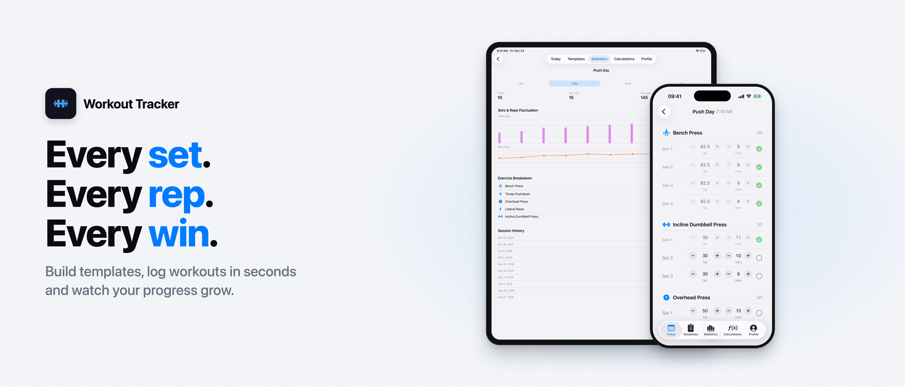
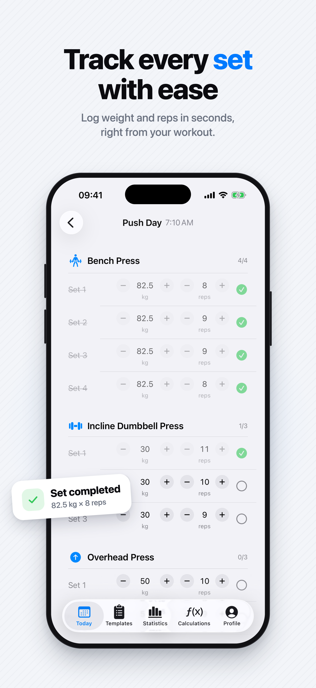
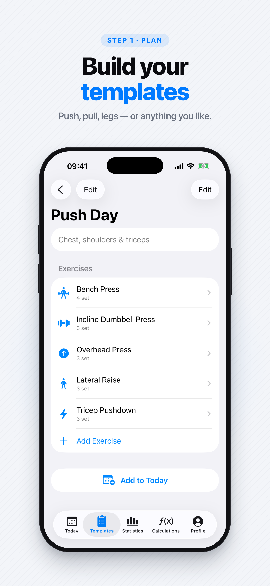
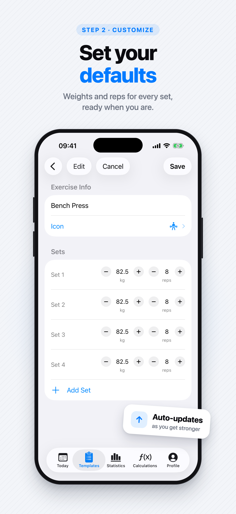
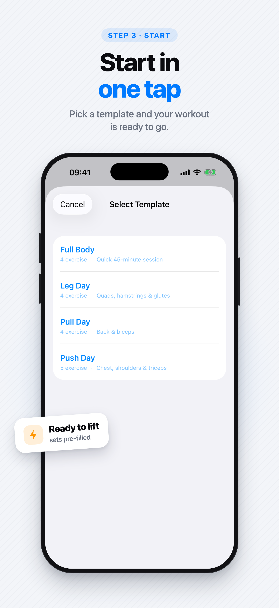
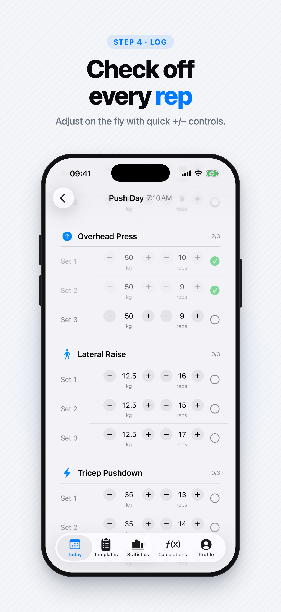
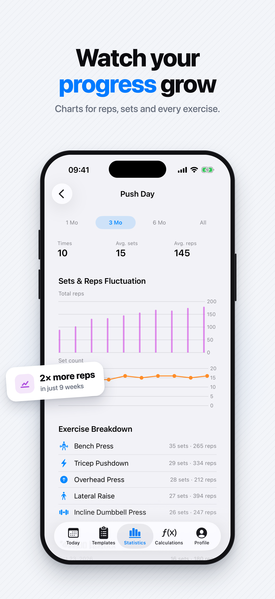
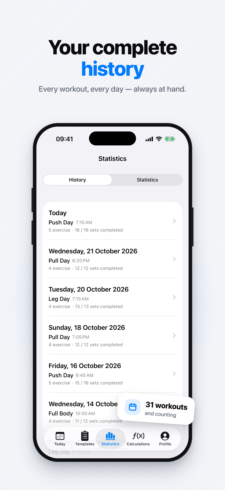
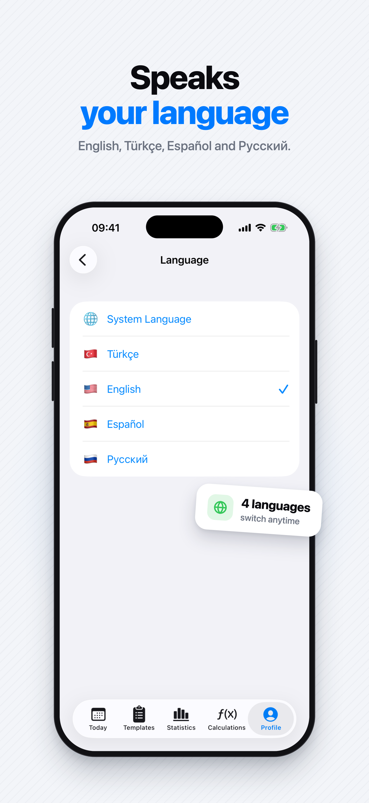

<p align="center">
  
</p>

<p align="center">
  <b>English</b> · <a href="README.tr.md">Türkçe</a>
</p>

# 🏋️ Workout Tracker

**Log your gym sessions without a notebook, a notes app or your memory.**
Build a template once, start it in one tap and tick off your sets with `−` / `+`. Next time, the app already knows the weight and reps you lifted last.


---

## 📸 Screenshots

<table>
  <tr>
    <td align="center"><br/><b>Log every set</b></td>
    <td align="center"><br/><b>Build templates</b></td>
    <td align="center"><br/><b>Set your defaults</b></td>
    <td align="center"><br/><b>Start in one tap</b></td>
  </tr>
  <tr>
    <td align="center"><br/><b>Check off every rep</b></td>
    <td align="center"><br/><b>Watch your progress</b></td>
    <td align="center"><br/><b>Complete history</b></td>
    <td align="center"><br/><b>Four languages</b></td>
  </tr>
</table>

| Screen | What it shows |
|---|---|
| **Workout session** | Exercise cards with kg (2.5 kg steps) and reps steppers per set; tap or swipe to complete a set |
| **Template detail** | The template's exercises, "Add Exercise", and "Add to Today" to start it right away |
| **Exercise edit** | Name, icon and the default kg/reps of every set, which update themselves as you get stronger |
| **Template picker** | Pick a template from Today and the workout opens with its sets pre-filled |
| **Logging** | Completed sets turn green and lock; the next open set is always one tap away |
| **Statistics** | 1M / 3M / 6M / All ranges, KPI cards, reps & sets charts and a per-exercise breakdown |
| **History** | Every workout grouped by day, with time and completed sets |
| **Language** | English, Türkçe, Español and Русский, switchable inside the app |

---

## 🎯 What problem does it solve?

The usual pain points at the gym:

- **"How much did I lift on this last week?"** Digging through old notes eats into your rest between sets.
- **Typing the same program every time.** General-purpose note apps make you re-enter exercises, set counts and weights for every session.
- **Typing with sweaty hands.** Entering kg/reps on a tiny number pad between sets is slow and error-prone.
- **Not seeing progress.** When your records are scattered, it's hard to tell whether you're actually getting stronger.

**Workout Tracker** handles them like this:

| Problem | Solution |
|---|---|
| Forgetting your last weight | The kg/reps of every completed set are **written back to the template**, so the next workout starts with your latest numbers. |
| Rewriting the program | Build the program once as a **template**, then add it to the day in one tap. |
| A keyboard between sets | No keyboard: weight moves in **2.5 kg** steps and reps in **1s** with `−` / `+` buttons. |
| Not seeing progress | **History** and **Statistics** chart session counts, average sets/reps and how they change over time. |

---

## ✨ Features

### 📅 Today
- Start the day's workout from any saved template
- Several workouts on the same day (e.g. cardio in the morning, weights in the evening)
- Exercise count and `completed / total sets` summary for each workout
- A **live timer** that starts as soon as the workout is added; finished workouts show their total time
- Long press a workout to delete it (with confirmation)

### 🏃 Workout session
- Exercise cards with **kg** and **reps** steppers for every set
- Tap to complete a set ✅. Completed sets lock and fade
- **Full swipe left → complete**, **full swipe right → skip**. Skipped sets turn grey and never count as completed
- **Copy** a set with the same kg/reps, or **delete** it from today's session only (the template stays as it is)
- **Undo** a set you completed by mistake; the value written to the template is restored too
- Long press an exercise to remove it from the session
- The bottom bar shows the live timer and **Finish**, which turns into *Cancel / Finish Workout* to confirm. **Resume** reopens a finished workout, and the gap isn't counted in the duration
- Live **heart rate** and **active energy** while the Apple Watch app is open

### 📋 Templates
- Create, edit and delete workout templates
- Add exercises with default sets, kg and reps
- Personalise exercises with SF Symbols through the **icon picker**
- **Drag and drop** to reorder exercises and sets
- **"Add to Today"** turns the template into today's workout and jumps to the Today tab

### 📊 Statistics
- **History:** every workout grouped by day (Today, Yesterday, full date) with its time
- **Statistics:** progression for each workout template
  - Ranges: **1 Month / 3 Months / 6 Months / All**
  - KPI cards: times done, average sets, average reps
  - **Reps** (bar chart) and **sets** (line chart) over time, built with Swift Charts
  - Per-exercise set/rep breakdown and session history
- Only sets that were actually **completed** are counted

### 🧮 Calculations
- **BMI:** category, a coloured scale and the healthy weight range for your height
- **Daily protein:** a g/day range for your weight and goal, plus the amount per meal
- **Daily water:** litres and glasses based on your weight and exercise time
- Weight and height come from your profile, so you only enter them once

### ⌚ Apple Watch
- The workout running on the iPhone shows up on the watch: timer, heart rate and a coloured per-set timeline
- Tap an exercise to open its next open set, adjust kg/reps with the **Digital Crown**, then **Complete / Skip / Delete**. The watch moves to the next set by itself
- Everything you do on the watch shows up right away on the iPhone, the Lock Screen and the Dynamic Island
- When a workout starts on the iPhone, the watch asks whether you want to continue there
- Average/max heart rate and active energy are saved with the finished workout

### 🔒 Lock Screen & Dynamic Island
- A **Live Activity** shows the running workout's timer, current exercise, set progress and next set (kg × reps)
- Also appears compactly in the Apple Watch **Smart Stack**
- Tap it to open the workout; it ends when you finish or delete the workout

### ⚙️ Settings & profile
- Name, surname, photo, weight and height
- Appearance: **Automatic / Light / Dark** and one of **8 theme colours**, used across the app, the Lock Screen and the Dynamic Island
- **iCloud sync:** templates and history sync between devices on the same Apple Account (can be turned off)
- **Backup:** export all data as a JSON file and restore it (existing records are skipped)
- **Apple Health:** save finished workouts to Health as strength training, or export your history in bulk
- Turn the Lock Screen card on or off
- **Release notes:** tap the version row in Profile to see what changed in each build

### 🌍 Languages
🇬🇧 English · 🇹🇷 Türkçe · 🇪🇸 Español · 🇷🇺 Русский. The system language is detected automatically and can be changed instantly inside the app.

---

## 🧠 How it works

The app is built on a **Template → Session** split:

```
WorkoutTemplate ──► ExerciseTemplate ──► SetTemplate (defaultKg, defaultReps)
       │                                        ▲
       │  TemplateSessionBuilder.build(from:)   │  TemplateDefaultUpdater.syncIfNeeded(...)
       ▼                                        │  (kg/reps written back when a set is completed)
WorkoutSession ───► ExerciseSession ───► SetSession (kg, reps, isCompleted, isSkipped)
```

1. A **template** is a plan you create once (e.g. "Push Day": Bench Press 4×8 @ 60 kg).
2. Starting a workout makes `TemplateSessionBuilder` take a **snapshot** of the template (the session).
3. Changes during the session (copying or deleting sets) don't touch the template.
4. When a set is completed, `TemplateDefaultUpdater` writes the real kg/reps to the template's set, so **progressive overload** is tracked on its own.
5. Sessions keep a **snapshot** of the exercise name and icon, so history stays intact even if the template is later edited or deleted.
6. Templates and sessions are linked by a stable `uuid` rather than a store-specific ID, so links survive backups, restores and iCloud sync.

The iPhone is the only data store. The Live Activity and the Apple Watch get snapshots of the running workout, and the watch sends commands back that the iPhone applies with the same code its own screens use.

---

## 🛠 Tech stack

| Layer | Technology |
|---|---|
| UI | SwiftUI |
| Data | SwiftData (`@Model`, `@Query`, `@Bindable`) |
| Charts | Swift Charts |
| Sync | SwiftData + CloudKit (private iCloud database) |
| Health | HealthKit (writes workouts; live heart rate on the watch) |
| Lock Screen | ActivityKit + WidgetKit (Live Activity, Dynamic Island, Smart Stack) |
| Watch | watchOS app + WatchConnectivity |
| Localisation | String Catalog (`Localizable.xcstrings`) + `LocalizationManager` |
| Architecture | No ViewModels; business logic lives in `Services/` |

No third-party dependencies, only Apple frameworks.

---

## 📁 Project structure

```
workout-tracker/       # iOS app
├── App/               # RootView (TabView), TabRouter
├── Models/            # Workout/Exercise/Set × Template/Session (SwiftData)
├── Services/          # Template→session, default updates, backup, iCloud, HealthKit, Live Activity, watch sync
├── Views/
│   ├── Today/         # Today, session detail, set rows
│   ├── Templates/     # Template list, detail, editing
│   ├── Stats/         # History, statistics, progress charts
│   ├── Calculations/  # BMI, protein and water calculators
│   └── Profile/       # Profile, settings (appearance, data, Live Activity, language), release notes
├── Components/        # SwipeRow, IconPickerView
└── Helpers/           # Localisation, theme, date/number formatting, stats and body calculations
WorkoutWatch/          # Apple Watch app
WorkoutWidgets/        # Live Activity (Lock Screen, Dynamic Island, Smart Stack)
Shared/                # Code shared by all three targets
Support/               # Info.plist additions
```

---

## 🚀 Getting started

**Requirements:** Xcode 26+, iOS 26.4+, watchOS 26.4+ (for the watch app)

```bash
git clone https://github.com/sedatbilece/workout-tracker.git
cd workout-tracker
open workout-tracker.xcodeproj
```

In Xcode, pick the `workout-tracker` scheme and run it on a simulator or device (`⌘R`).

> **Running on a device / iCloud:** The project uses iCloud (CloudKit), Push and HealthKit entitlements. When signing with your own team, pick an iCloud container under *Signing & Capabilities* (`iCloud.sedatbilece.workout-tracker` or one that matches your bundle ID). The app also works with local data without the iCloud entitlement.

---

## 🗺 Roadmap

- [x] Template-based workout management
- [x] Set completion with automatic sync back to the template
- [x] Swipe to complete / skip / copy / delete sets
- [x] Multiple languages (EN, TR, ES, RU)
- [x] History and per-template progress statistics
- [x] iCloud sync, JSON backup / restore
- [x] Workout timer and Apple Health integration
- [x] Lock Screen & Dynamic Island Live Activity
- [x] BMI, protein and water calculators
- [x] Apple Watch app with live heart rate
- [ ] Per-exercise statistics (max weight, volume trend)
- [ ] More calculators (1RM, plate calculator)
- [ ] Rest timer between sets

See [CHANGELOG.md](CHANGELOG.md) for the version history.
