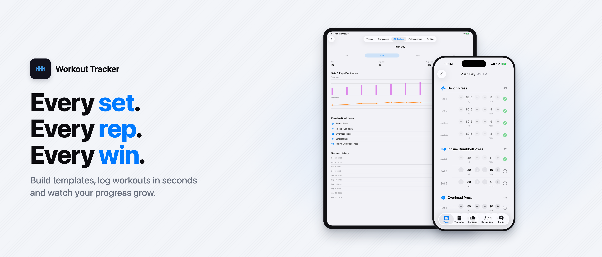
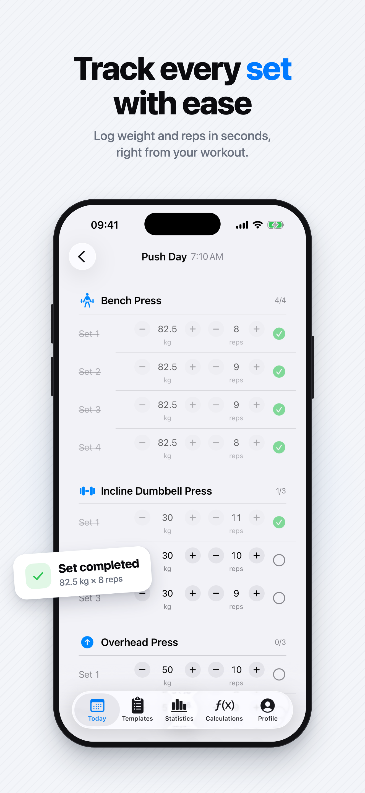
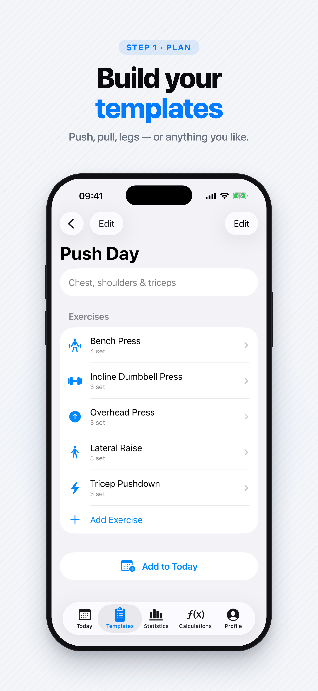
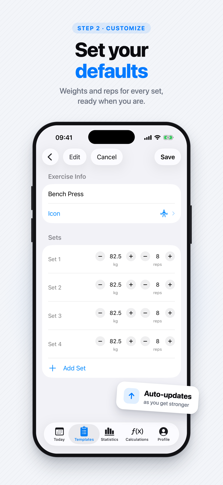
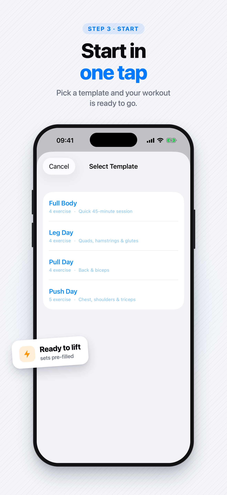
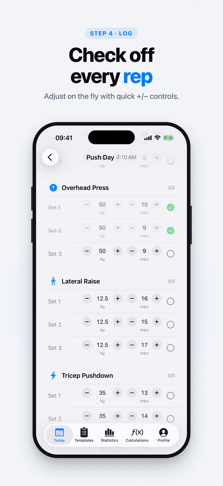
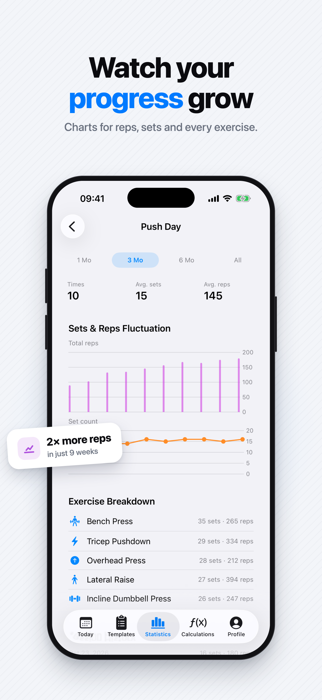
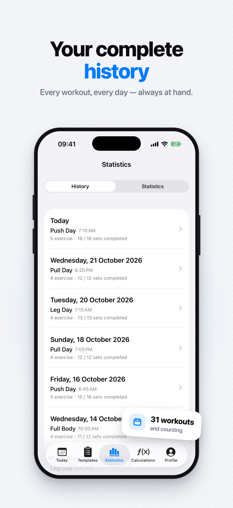
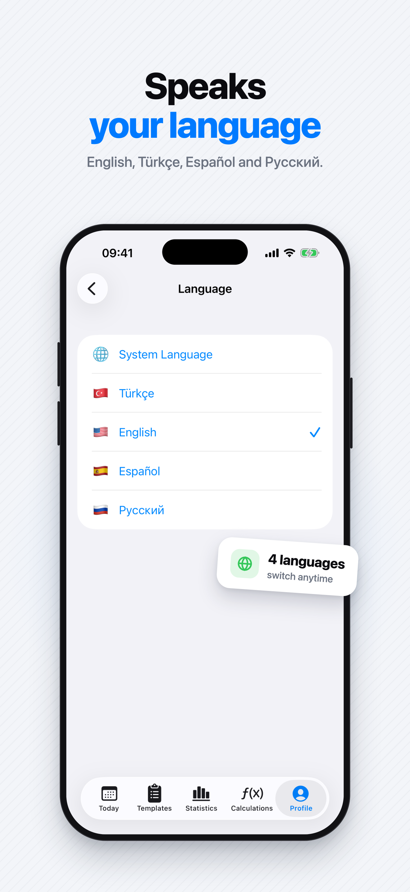

<p align="center">
  
</p>

<p align="center">
  <a href="README.md">English</a> · <b>Türkçe</b>
</p>

# 🏋️ Workout Tracker

**Salonda defter, not uygulaması ya da hafızayla uğraşmadan antrenmanını kaydet.**
Şablonunu bir kez oluştur, her antrenmanda tek dokunuşla başlat, setlerini `−` / `+` ile işaretle. Bir sonraki antrenmanda uygulama son kaldırdığın ağırlığı ve tekrarı hatırlıyor.


---

## 📸 Ekran Görüntüleri

<table>
  <tr>
    <td align="center"><br/><b>Her seti kaydet</b></td>
    <td align="center"><br/><b>Şablonunu oluştur</b></td>
    <td align="center"><br/><b>Varsayılanları belirle</b></td>
    <td align="center"><br/><b>Tek dokunuşla başlat</b></td>
  </tr>
  <tr>
    <td align="center"><br/><b>Her tekrarı işaretle</b></td>
    <td align="center"><br/><b>İlerlemeni izle</b></td>
    <td align="center"><br/><b>Tüm geçmiş</b></td>
    <td align="center"><br/><b>Dört dil</b></td>
  </tr>
</table>

| Ekran | Ne gösteriyor? |
|---|---|
| **Antrenman Seansı** | Hareket kartları, her set için kg (2,5 kg adım) ve tekrar stepper'ları; dokunarak ya da kaydırarak set tamamlama |
| **Şablon Detayı** | Şablondaki hareketler, "Hareket Ekle" ve şablonu hemen başlatan "Bugüne Ekle" |
| **Hareket Düzenleme** | Ad, ikon ve her setin varsayılan kg/tekrarı; güçlendikçe kendiliğinden güncelleniyor |
| **Şablon Seçimi** | Bugün ekranından şablon seçilince antrenman setleri dolu olarak açılıyor |
| **Set İşaretleme** | Tamamlanan setler yeşile dönüp kilitleniyor; sıradaki açık set hep bir dokunuş uzakta |
| **İstatistikler** | 1 Ay / 3 Ay / 6 Ay / Tümü aralıkları, KPI kartları, tekrar & set grafikleri ve hareket kırılımı |
| **Geçmiş** | Günlere göre gruplanmış tüm antrenmanlar, saat ve tamamlanan setlerle |
| **Dil** | English, Türkçe, Español ve Русский; uygulama içinden değiştirilebiliyor |

> Görseller App Store için hazırlanan İngilizce ekran görüntüleridir; uygulama Türkçe de kullanılabilir.

---

## 🎯 Hangi Sorunu Çözüyor?

Salonda antrenman yaparken en sık yaşanan dertler:

- **"Geçen hafta bu harekette kaç kilo kaldırmıştım?"** Not defterinde ya da telefon notlarında eski kayıtları aramak setler arası dinlenmeyi yiyip bitiriyor.
- **Her antrenmanda aynı programı baştan yazmak.** Genel not uygulamalarında hareketleri, set sayılarını ve ağırlıkları her seferinde yeniden girmek gerekiyor.
- **Terli ellerle klavye kullanmak.** Set arasında küçük sayı klavyesiyle kg/tekrar yazmak hem yavaş hem hataya açık.
- **İlerlemeyi görememek.** Kayıtlar dağınık olunca haftalar içinde gerçekten gelişip gelişmediğini anlamak zorlaşıyor.

**Workout Tracker** bunları şöyle çözer:

| Sorun | Çözüm |
|---|---|
| Son ağırlığı hatırlamamak | Tamamlanan her setin kg/tekrarı **şablona geri yazılır**; bir sonraki antrenman son değerlerle başlar. |
| Programı her seferinde yazmak | Program bir kez **şablon** olarak oluşturulur, sonra tek dokunuşla o güne eklenir. |
| Set arasında klavye | Klavye yok: ağırlık **2,5 kg**, tekrar **1'er** adımla `−` / `+` butonlarıyla ayarlanır. |
| İlerlemeyi görememek | **Geçmiş** ve **İstatistik** ekranları seans sayısını, ortalama set/tekrarı ve zaman içindeki değişimi grafikle gösterir. |

---

## ✨ Özellikler

### 📅 Bugün
- Kayıtlı şablonlardan birini seçerek günün antrenmanını başlatma
- Aynı gün içinde birden fazla antrenman (ör. sabah kardiyo + akşam ağırlık)
- Her antrenman için hareket sayısı ve `tamamlanan / toplam set` özeti
- Antrenman eklendiği an başlayan **canlı süre sayacı**; bitirilen antrenmanlarda toplam süre
- Uzun basarak antrenmanı silme (onaylı)

### 🏃 Antrenman Seansı
- Hareket kartları ve her set için **kg** ve **tekrar** stepper'ları
- Dokunarak seti tamamlama ✅; tamamlanan set kilitlenir ve soluklaşır
- **Sola sonuna kadar kaydır → tamamla**, **sağa sonuna kadar kaydır → pas geç**. Atlanan set gri görünür ve tamamlanmış sayılmaz
- Seti aynı kg/tekrarla **kopyalama** ya da yalnızca o günkü seanstan **silme** (şablon etkilenmez)
- Yanlışlıkla tamamlanan seti **Geri Al**; şablona yazılan değer de eski haline döner
- Harekete uzun basarak onu seanstan çıkarma
- Alttaki çubukta canlı süre ve **Bitir**; onay için bar *İptal / Antrenmanı Bitir* butonlarına dönüşür. **Devam Et** bitirilen antrenmanı yeniden açar, aradaki bekleme süreye eklenmez
- Apple Watch uygulaması açıkken canlı **nabız** ve **aktif kalori**

### 📋 Şablonlar
- Antrenman şablonu oluşturma / düzenleme / silme
- Şablona hareket ekleme, her hareket için varsayılan set, kg ve tekrar tanımlama
- **İkon seçici** ile hareketleri SF Symbols ikonlarıyla kişiselleştirme
- Hareketleri ve setleri **sürükle-bırak** ile yeniden sıralama
- **"Bugüne Ekle"** ile şablonu doğrudan günün antrenmanı yapıp Bugün sekmesine geçme

### 📊 İstatistikler
- **Geçmiş:** Tüm antrenmanlar gün bazında gruplanır (Bugün, Dün, tam tarih) ve saatleriyle listelenir
- **İstatistik:** Her antrenman şablonu için ilerleme detayı
  - Zaman aralığı: **1 Ay / 3 Ay / 6 Ay / Tümü**
  - KPI kartları: yapılma sayısı, ortalama set, ortalama tekrar
  - **Tekrar** (bar grafik) ve **set** (çizgi grafik) değişimi, Swift Charts ile
  - Hareket bazında set/tekrar dağılımı ve seans geçmişi
- Yalnızca gerçekten **tamamlanan** setler hesaba katılır

### 🧮 Hesaplamalar
- **Vücut Kitle İndeksi:** kategori, renkli ölçek ve boya göre sağlıklı kilo aralığı
- **Günlük Protein:** kilo ve hedefe göre g/gün aralığı ve öğün başına miktar
- **Günlük Su:** kilo ve egzersiz süresine göre litre ve bardak sayısı
- Kilo ve boy profilden geliyor; bir kez girmek yetiyor

### ⌚ Apple Watch
- iPhone'da açık olan antrenman saatte de görünür: süre, nabız ve set başına renkli zaman çizelgesi
- Harekete dokununca sıradaki açık set açılır; kg/tekrar **Digital Crown** ile ayarlanır, **Tamamla / Pas geç / Sil** ile işlenir ve saat kendiliğinden sıradaki sete geçer
- Saatte yapılan her şey anında iPhone'a, kilit ekranına ve Dinamik Ada'ya yansır
- iPhone'da antrenman başlayınca saat "saatten devam etmek ister misin?" diye sorar
- Ortalama/maksimum nabız ve aktif kalori bitirilen antrenmanla birlikte saklanır

### 🔒 Kilit Ekranı ve Dinamik Ada
- **Live Activity**, çalışan antrenmanın süresini, o anki hareketi, set ilerlemesini ve sıradaki seti (kg × tekrar) gösterir
- Apple Watch **Smart Stack**'te de kompakt olarak görünür
- Karta dokununca antrenman açılır; Bitir ya da silme ile kapanır

### ⚙️ Ayarlar ve Profil
- Ad, soyad, fotoğraf, kilo ve boy
- Görünüm: **Otomatik / Aydınlık / Karanlık** ve **8 tema renginden** biri; uygulamada, kilit ekranında ve Dinamik Ada'da kullanılır
- **iCloud senkronu:** Şablonlar ve geçmiş, aynı Apple hesabını kullanan cihazlar arasında senkronize edilir (kapatılabilir)
- **Yedek:** Tüm veriyi JSON dosyası olarak dışa aktarma ve geri yükleme (var olan kayıtlar atlanır)
- **Apple Sağlık:** Bitirilen antrenmanları Sağlık'a kuvvet antrenmanı olarak kaydetme, geçmişi toplu aktarma
- Kilit ekranı kartını açıp kapatma
- **Sürüm notları:** Profil'deki sürüm satırına dokununca her build'de nelerin değiştiği görünür

### 🌍 Çoklu Dil
🇹🇷 Türkçe · 🇬🇧 English · 🇪🇸 Español · 🇷🇺 Русский. Sistem dili otomatik algılanır, uygulama içinden anında değiştirilebilir.

---

## 🧠 Nasıl Çalışır?

Uygulama **Şablon → Seans** ayrımı üzerine kuruludur:

```
WorkoutTemplate ──► ExerciseTemplate ──► SetTemplate (defaultKg, defaultReps)
       │                                        ▲
       │  TemplateSessionBuilder.build(from:)   │  TemplateDefaultUpdater.syncIfNeeded(...)
       ▼                                        │  (set tamamlanınca kg/tekrar geri yazılır)
WorkoutSession ───► ExerciseSession ───► SetSession (kg, reps, isCompleted, isSkipped)
```

1. **Şablon** bir kez oluşturulan plandır (ör. "Push Day": Bench Press 4×8 @ 60 kg).
2. Antrenman başlatıldığında `TemplateSessionBuilder` şablonun bir **anlık kopyasını** (seans) oluşturur.
3. Seans sırasında yapılan değişiklikler (set kopyalama, silme) şablonu bozmaz.
4. Bir set tamamlandığında `TemplateDefaultUpdater` gerçek kg/tekrarı şablondaki sete yazar; **progressive overload** kendiliğinden takip edilir.
5. Seanslar hareket adı ve ikonunun **snapshot**'ını tutar; şablon sonradan değişse ya da silinse bile geçmiş kayıtlar bozulmaz.
6. Şablon ile seans, store'a özel bir kimlik yerine kalıcı bir `uuid` ile bağlanır; bağlantı yedek, geri yükleme ve iCloud senkronundan sonra da korunur.

Tek veri kaynağı iPhone'dur. Live Activity ve Apple Watch çalışan antrenmanın anlık görüntüsünü alır; saatin gönderdiği komutları iPhone, kendi ekranlarının kullandığı kodla uygular.

---

## 🛠 Teknolojiler

| Katman | Teknoloji |
|---|---|
| UI | SwiftUI |
| Veri | SwiftData (`@Model`, `@Query`, `@Bindable`) |
| Grafikler | Swift Charts |
| Senkron | SwiftData + CloudKit (özel iCloud veritabanı) |
| Sağlık | HealthKit (antrenman yazma; saatte canlı nabız) |
| Kilit Ekranı | ActivityKit + WidgetKit (Live Activity, Dinamik Ada, Smart Stack) |
| Saat | watchOS uygulaması + WatchConnectivity |
| Lokalizasyon | String Catalog (`Localizable.xcstrings`) + `LocalizationManager` |
| Mimari | ViewModel'siz; iş mantığı `Services/` altında |

Harici bağımlılık yoktur, sadece Apple framework'leri.

---

## 📁 Proje Yapısı

```
workout-tracker/       # iOS uygulaması
├── App/               # RootView (TabView), TabRouter
├── Models/            # Workout/Exercise/Set × Template/Session (SwiftData)
├── Services/          # Şablon→seans, varsayılan güncelleme, yedek, iCloud, HealthKit, Live Activity, saat senkronu
├── Views/
│   ├── Today/         # Bugün, seans detayı, set satırları
│   ├── Templates/     # Şablon listesi, detay, düzenleme
│   ├── Stats/         # Geçmiş, istatistik, ilerleme grafikleri
│   ├── Calculations/  # VKİ, protein ve su hesaplayıcıları
│   └── Profile/       # Profil, ayarlar (görünüm, veri, Live Activity, dil), sürüm notları
├── Components/        # SwipeRow, IconPickerView
└── Helpers/           # Lokalizasyon, tema, tarih/sayı formatlama, istatistik ve vücut hesapları
WorkoutWatch/          # Apple Watch uygulaması
WorkoutWidgets/        # Live Activity (kilit ekranı, Dinamik Ada, Smart Stack)
Shared/                # Üç hedefin ortak kodu
Support/               # Info.plist eklemeleri
```

---

## 🚀 Kurulum

**Gereksinimler:** Xcode 26+, iOS 26.4+, watchOS 26.4+ (saat uygulaması için)

```bash
git clone https://github.com/sedatbilece/workout-tracker.git
cd workout-tracker
open workout-tracker.xcodeproj
```

Xcode'da `workout-tracker` şemasını seçip bir simülatör ya da cihazda çalıştırın (`⌘R`).

> **Cihazda çalıştırma / iCloud:** Proje iCloud (CloudKit), Push ve HealthKit yetkilerini kullanır. Kendi takımınızla imzalarken *Signing & Capabilities* sekmesinde iCloud container'ı (`iCloud.sedatbilece.workout-tracker` ya da kendi bundle ID'nize uygun bir container) seçin. iCloud yetkisi olmadan da uygulama yerel veriyle çalışır.

---

## 🗺 Yol Haritası

- [x] Şablon tabanlı antrenman yönetimi
- [x] Set tamamlama ve şablona otomatik senkron
- [x] Kaydırarak set tamamlama / pas geçme / kopyalama / silme
- [x] Çoklu dil desteği (TR, EN, ES, RU)
- [x] Geçmiş ve şablon bazlı ilerleme istatistikleri
- [x] iCloud senkronu, JSON yedek / geri yükleme
- [x] Antrenman süresi ve Apple Sağlık entegrasyonu
- [x] Kilit ekranı ve Dinamik Ada (Live Activity)
- [x] VKİ, protein ve su hesaplayıcıları
- [x] Canlı nabızlı Apple Watch uygulaması
- [ ] Hareket bazlı istatistikler (maks. ağırlık, hacim trendi)
- [ ] Yeni hesaplayıcılar (1RM, plaka hesaplayıcı)
- [ ] Set arası dinlenme zamanlayıcısı

Sürüm geçmişi için [CHANGELOG.md](CHANGELOG.md) dosyasına bakın.
